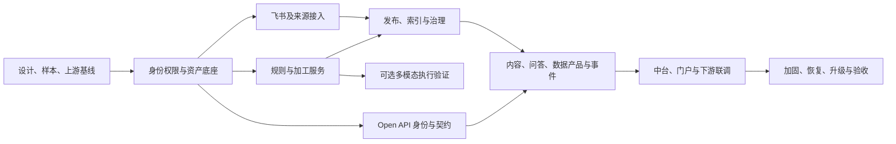

# CHINT 集团知识中心与非结构化数据中台开发计划

版本：V0.1（开发计划草案）  
日期：2026-10-11  
开发主线：`chint`  
状态：S0 设计与适配验证进行中，已启动组织人员底座第一批开发。

开发记录：[组织人员导入](./chint/DIRECTORY_DEVELOPMENT.md)。F02/F03 已完成首批目录与账号映射代码，尚不等于全部组织权限能力完成。

S0 工作包：[设计与适配验证](./chint/s0/README.md)。本轮确认首个样板为制度与操作规程；组织人员通过每日定时导入；OAuth2 登录集成后补；飞书三个租户通过后台配置；下游系统待定。

## 1. 输入与实施原则

计划依据：

- [需求说明书 V0.4](./GROUP_UNSTRUCTURED_DATA_PLATFORM_REQUIREMENTS.md)
- [总体架构方案 V0.4](./GROUP_UNSTRUCTURED_DATA_PLATFORM_ARCHITECTURE.md)
- [Open API 方案 V0.1](./GROUP_UNSTRUCTURED_DATA_PLATFORM_OPEN_API.md)

按“独立中台模块与加工服务 + WeKnora 适配层 + 必要核心扩展”实施。集团资产、权限、规则和发布事实由中台管理，WeKnora 尽量复用检索、问答、Agent 和知识界面。具体扩展点必须经过源码及真实样本验证，不把逻辑模块一律拆成独立微服务。

本地环境已经启动 WeKnora 发布镜像，用户已配置并测试模型；这不等于集团功能已经实现，也不代表全部需求已冻结。开发前核对镜像与本地源码提交差异，建立一致的构建和测试基线。

需求、架构和接口文档中的未决项在设计阶段形成决策记录。原文档不含排期，本计划是独立新增的实施视图，不将估算反写为已经批准的架构承诺。

## 2. 交付范围

### 2.1 集团基础版本必须形成的闭环

1. 集团组织、统一登录、知识空间、资产责任人与受控共享。
2. 文件上传和飞书文档/云盘/知识库接入，保留来源、版本及权限。
3. 原始区、标准区、服务区及统一资产标识。
4. 版本化规则与管道，清洗、脱敏、字段抽取、分块及质量复核。
5. 批次快照、进度、失败恢复、重试、取消及逐资产报告。
6. 发布审批与版本切换，受控检索、问答、引用和文件读取。
7. 集团目录/主数据对接、数据门户入口及代表性下游集成。
8. 授权 Open API、同步基线、增量、撤权/删除通知与对账。
9. 审计、配额、监控、备份恢复及社区版本升级验证。

### 2.2 扩展范围单独验证和估算

- Ray/Vane 多模态执行后端，音视频专项处理和 GPU 资源池。
- 飞书结果写回、在线嵌入及更多格式覆盖。
- 图谱、复杂 Wiki 聚合和 Agent 自动执行外部业务操作。
- 额外业务系统连接器、多地域/高密级独立数据平面。

扩展需求保留在总范围内，不能因为本计划分组而视为已取消。执行后端接口在基础版本设计中预留；没有明确多模态业务样本时，不强制同时部署 Ray Data 与 Vane Data。

## 3. 功能归属与改造边界

| 工作领域 | 复用基础 | 新增或扩展 | 维护策略 |
| --- | --- | --- | --- |
| 身份与空间 | WeKnora 空间、成员与角色 | 集团组织映射、SSO、外部主体与调岗离职 | 集团适配模块；统一验证读取权限 |
| 权限 | 资源访问检查、文件授权、API Key | 文档策略、源 ACL、当前权限决策、撤权传播 | 集中扩展点；权限关键链路回归 |
| 数据接入 | 文件上传、现有飞书连接器 | 统一来源契约、增量对账、源权限、集团连接器 | 适配层和接入模块，避免重复采集实现 |
| 数据资产 | 知识库、文档与存储抽象 | 资产 ID、Raw/Curated/Serving、版本与血缘 | 独立表/Schema；维护 WeKnora ID 映射 |
| ELT | docreader、内置解析及部分加工能力 | 规则中心、管道、标准产物、质量与批次 | 执行适配服务；算子按可复用性拆分 |
| 发布与索引 | 分块、向量化及检索 | 发布清单、版本切换、失效与补偿 | 不依赖临时写库；适配已确认接口 |
| 知识应用 | 检索、问答、Agent、引用 | 集团入口、授权范围、业务主题与状态展示 | 小范围核心补丁与独立 UI 模块 |
| Open API | 当前聊天/检索 API | 集团稳定契约、数据产品、订阅与交付 | 下游调用集团接口，适配上游变化 |
| 运维 | 日志、任务队列、追踪基础 | 组织配额、SLA、成本、灾备和版本兼容 | 独立部署配置与升级检查 |

避免两套系统重复解析或重复 Embedding 同一资料：设计阶段确认标准产物能否被 WeKnora 接收、是否需要新增导入扩展点，以及两层各自负责哪些步骤。该决策是加工和索引开发的前置条件。

## 4. 阶段计划与验收门槛

以下按依赖顺序划分，不意味着阶段内所有任务必须串行。工期是人手与外部接口条件满足时的粗估，见第 9 节。

| 阶段 | 主要工作 | 交付物 | 完成门槛 | 粗估历时 |
| --- | --- | --- | --- | --- |
| S0 设计与适配验证 | 范围、组织权限、系统清单、样本、数据模型、上游基线 | 决策记录、接口契约、差距清单、回归基线 | 关键外部接口可验证，授权与资产归属明确 | 1–2 周 |
| S1 身份权限与资产底座 | 每日组织人员导入、本地账号映射、组织/空间、资源策略、资产版本、存储分区、来源映射 | 集团底座及开发环境、原始资产管理 | 两组织隔离；原件和元数据有明确归属及当前授权 | 3–4 周 |
| S2 接入与飞书同步 | 来源契约、文件/对象接入、飞书范围、增量对账与源 ACL | 接入控制台、飞书连接器增强、同步报告 | 更新/移动/撤权可处理，失败不误删，原始版本可追溯 | 3–4 周 |
| S3 ELT 与受控知识发布 | 规则管道、批处理、质量复核、发布、WeKnora 索引适配 | 统一加工服务、标准产物、组织知识工作台 | 一个业务模板端到端跑通；撤权覆盖知识服务和派生内容 | 4–6 周 |
| S4 集团集成与 Open API | 中台目录/主数据、门户、下游身份、接口与事件 | 稳定 API、开发者文档、代表性消费闭环 | 系统与代用户授权正确；同步基线、增量、撤销回执可对账 | 3–5 周 |
| S5 加固与生产验收 | 权限回归、容量、故障、恢复、升级、试运行 | 测试报告、运行手册、上线及回退方案 | 验收门槛全部通过，重大权限/数据风险已关闭 | 2–4 周 |
| SX 多模态与可选能力 | Ray/Vane、音视频、写回、图谱等 | 执行后端评估与批准能力 | 样本质量、性能、成本、隔离及恢复验证通过 | 单独估算 |

阶段完成按可验证结果判定。接口未获授权、源权限无法映射、质量阈值未确认等问题，不能通过“界面已完成”绕过。

## 5. 开发任务拆分（WBS）

优先级：P0 为基础闭环或安全必需；P1 为完整治理/集成的重要能力；P2 为待批准的扩展。优先级不改变生产发布所需的验收要求。责任角色是建议，不代表人员已分配。

| ID | 任务 | 优先级 | 主要依赖 | 建议责任角色 | 交付与验收 |
| --- | --- | --- | --- | --- | --- |
| D01 | 明确试点组织、业务流程、首批系统、格式和容量 | P0 | 无 | 产品/架构、业务责任人 | 范围清单与典型业务用例 |
| D02 | 冻结主体、空间、资产授权矩阵及源权限处理 | P0 | D01 | 架构、后端、安全 | 每个操作的允许/拒绝样例与权限新鲜度要求 |
| D03 | 核对 WeKnora 基线与复用扩展点，验证标准产物导入 | P0 | D01 | 后端、数据工程 | 源码/镜像差异、补丁清单、解析到索引适配结论 |
| D04 | 设计资产、版本、规则、任务、发布与事件 Schema | P0 | D02、D03 | 架构、后端、数据工程 | 数据模型、状态机、契约与迁移方案 |
| D05 | 建立样本集、权限矩阵测试及构建回归基线 | P0 | D01、D02 | 测试、开发 | 样本预期结果，正向与越权回归入口 |
| F01 | CHINT 构建、开发/测试环境及独立迁移 | P0 | D03 | 后端、运维 | 源码镜像可复现、配置不泄露、迁移可验证 |
| F02 | 每日组织人员导入、本地账号映射与紧急停用；OAuth2 后补 | P0 | D02、主数据导入契约 | 后端/集成 | 批次校验、稳定 ID、调岗离职与失败恢复可验收；OAuth2 单独联调 |
| F03 | 多级组织与空间模型、责任人、角色及成员管理 | P0 | D04、F02 | 后端、前端 | 组织工作台，层级不自动授予正文读取 |
| F04 | 集中授权扩展，覆盖搜索、Agent、引用、文件和历史 | P0 | D02、D03、F03 | 后端、安全、测试 | 所有知识出口遵循当前策略；默认封闭 |
| F05 | 原始/标准/服务分区、资产 ID 与 WeKnora ID 映射 | P0 | D04、F01 | 后端、数据工程 | 对象校验、版本登记、幂等映射与受控读取 |
| F06 | 凭据引用、任务身份和模型准入 | P0 | F04、F05 | 后端、运维 | 任务只读授权输入，不能关闭强制策略 |
| I01 | 接入契约、来源对象、上传、批次和水位 | P0 | F04、F05 | 数据工程、后端 | 重复采集不重复创建；来源不能伪造 |
| I02 | 飞书多租户后台配置、凭据管理、计划与目录采集 | P0 | I01、飞书应用授权 | 数据工程、前端 | 文档/云盘/知识库样本及原文回跳 |
| I03 | 飞书主体、源 ACL、权限继承与新鲜度策略 | P0 | F02、F04、I02 | 后端/集成、安全 | 采集身份与阅读身份分离；无法映射不放宽 |
| I04 | 飞书增量、移动、删除、撤权、对账与补偿 | P0 | I02、I03 | 数据工程、测试 | 丢事件可补齐；单次失败不误判删除 |
| I05 | 通用对象存储/API 连接器与连接状态界面 | P1 | I01 | 数据工程、前端 | 限定来源、凭据隔离、任务及错误可见 |
| P01 | 规则版本、继承、条件、参数及冲突校验 | P0 | D04、F06 | 后端、前端 | 集团强制规则不可覆盖；解析规则集固定 |
| P02 | 算子契约与执行适配，复用解析能力 | P0 | D03、D04、F05 | 数据工程、后端 | 标准正文/表格/图片与来源定位符合 Schema |
| P03 | 清洗、脱敏、字段模板与模型输出校验 | P0 | P01、P02、业务规则样本 | 数据工程、业务责任人 | 每类规则有输入、预期输出和质量门槛 |
| P04 | 管道编排、分支及人工复核 | P0 | P01、P02 | 后端、前端 | 版本化管道，复核结果可追溯 |
| P05 | 批次快照、幂等、重试、取消与检查点 | P0 | P04、F06 | 后端、数据工程 | 固定输入；取消后迟到结果不发布 |
| P06 | 样本试跑、差异、批次报告与质量问题闭环 | P1 | P03、P05 | 前端、后端、测试 | 成功/失败/跳过/待复核逐项报告 |
| G01 | 元数据、分类、业务主键和责任管理 | P0 | F05、集团标准 | 后端、数据工程、前端 | 资产字段完整，主体和数据类型约束明确 |
| G02 | 发布审批、产物清单、索引代次与条件切换 | P0 | P05、F04、D03 | 后端、数据工程 | 旧任务不覆盖新发布，失败可保留有效版本 |
| G03 | 归档/停用、撤权、删除及清理补偿 | P0 | G02、I04 | 后端、数据工程 | 先停止访问后清理；传播状态可追踪 |
| G04 | 血缘、版本追溯、质量与审计查询 | P1 | P02、P05、G02 | 后端、前端 | 可从交付结果定位到原始版本与规则 |
| U01 | 集团/组织工作台与授权资产目录 | P0 | F03、G01 | 前端、后端 | 目录发现、正文读取和管理入口分别授权 |
| U02 | 共享申请、复核、发布与质量处理界面 | P1 | F04、P04、G02 | 前端、后端 | 流程绑定责任人、范围、期限及审批记录 |
| U03 | WeKnora 搜索、问答、引用及外部会话适配 | P0 | F04、G02 | 后端、前端 | 只使用允许的发布版本，外部用户会话隔离 |
| A01 | 应用登记、系统/用户委托、Scopes、配额 | P0 | F02、F04、Open API 契约 | 后端/集成 | 身份可验证，传入用户 ID 不作为授权证据 |
| A02 | 目录、内容、文件、检索、抽取结果 API | P0 | G01、G02、A01 | 后端 | Schema、错误码、分页和字段投影验证通过 |
| A03 | 问答 SSE、会话映射、引用及下游聊天适配 | P0 | U03、A01 | 后端、前端/消费方 | 会话归属、停止/错误/完成、代理缓冲可验证 |
| A04 | 加工、上传、导出等受控异步接口 | P1 | P05、G02、A01 | 后端 | 幂等、状态、版本冲突与撤权后读取限制 |
| A05 | 同步快照、增量、Webhook、回执、Outbox 与对账 | P0 | G02、G03、A01 | 后端、集成 | 失权仍发最小失效通知；新授权补历史基线 |
| A06 | 质量/血缘/反馈/申请接口与开发者材料 | P1 | G04、A02 | 后端、测试 | 机器可读规范、示例、契约测试和错误指南 |
| X01 | 集团目录/主数据/质量血缘映射 | P0 | G01、G04、A02、集团接口 | 集成、数据工程 | 明确权威字段、ID 映射及数据责任 |
| X02 | 集团门户 SSO、入口、授权目录与问答 | P0 | F02、U01、A03、门户契约 | 前端、集成、门户团队 | 真实用户端到端访问及权限申请闭环 |
| X03 | 代表性上游接入与下游数据产品交付 | P0 | I01、P03、A02、A05、业务接口 | 集成、数据工程、消费方 | 更新、撤销、回执和业务主键对账通过 |
| O01 | 指标、告警、审计、成本与组织资源配额 | P0 | F01；贯穿后续任务 | 运维、后端 | 积压、撤权滞后、失败、质量及费用可观察 |
| O02 | 容量压测、故障注入、备份与恢复演练 | P0 | 完整闭环、容量指标 | 测试、运维、后端 | 对照约定 SLA/RPO/RTO 和负载报告 |
| O03 | 上游版本合并、迁移与兼容验证 | P0 | D03、D05；贯穿每次升级 | 后端、测试、运维 | 升级分支、补丁审核、结果报告与回退条件 |
| O04 | 试点验收、问题修复、生产部署与操作培训 | P0 | O02、O03、业务验收 | 产品、测试、运维、业务 | 验收清单、运行手册及发布记录 |
| M01 | 多模态样本、执行器选型与资源验证 | P2 | P02、P03、多模态样本/GPU | 数据工程、运维、测试 | Ray/Vane 等候选按质量、吞吐及成本比较 |
| M02 | 选定多模态后端、音视频产物与模型资源池 | P2 | M01、P05、F06 | 数据工程、后端 | 时间/帧定位、隔离、恢复、成本与准入 |
| E01 | 飞书写回/嵌入、图谱、Wiki 和 Agent 场景扩展 | P2 | 完整权限发布链、各场景批准 | 前后端、数据工程 | 独立契约、防循环及派生权限回归 |

## 6. 关键依赖与工作安排

- F02–F06 的授权与资产契约稳定后，接入、规则加工和 API 契约可分线开发；涉及相同数据模型的修改统一评审。
- 前端可以用契约样例开发工作台，但正式完成依赖真实服务及权限验证。
- 部分 X01、X02 的接口评审在 S0 开始，不等功能开发完才申请集团接入。
- O01、O03 从基线阶段开始，O02 的针对性测试随模块推进；S5 集中做完整链路验证，不把测试全部留到最后。
- 飞书源权限和原始版本必须接入通用资产模型；不允许先形成权限不明的全集团索引再补安全。
- 下游可以先在独立演示数据上验证现有聊天 API，但集团上线需要完成 A01、A03 及对应数据授权。

关键路径主要取决于组织/源权限契约、资产与发布模型、处理规则样本和集团系统授权。具体人员排程需在这些条件确认后细化。

## 7. 测试与验收计划

| 验证领域 | 必须覆盖的场景 | 验收依据 |
| --- | --- | --- |
| 组织与权限 | 两组织、共享到期、调岗离职、来源失权、外部主体、文件直链与历史输出 | D02 权限矩阵与约定撤权时限 |
| 飞书同步 | 新增、改文、重名、移动、跨节点引用、撤权、删除、限流、事件遗漏 | 源对象与平台对象对账，不误删、不放宽 |
| ELT 质量 | 原生/扫描 PDF、Office、表格、图片；规则预期、字段证据、脱敏与复核 | 业务样本集及逐类型质量门槛 |
| 批处理 | 重复提交、混合权限、部分失败、源更新、暂停/取消、Worker 中断 | 幂等和状态机，不发布过期结果 |
| 发布与索引 | 构建失败、并发新旧发布、撤权、索引滞后、版本回退 | 条件切换与当前权限；无未经发布的服务输出 |
| Open API | 应用/用户范围、错误、限流、SSE、任务和导出撤权 | 契约测试及真实消费方验收 |
| 事件交付 | 快照增量衔接、乱序、重复、失权事件、新授权、游标过期 | 不丢有效状态，副本回执与对账 |
| 集团集成 | 主数据/目录映射、门户身份、业务主键、端到端变更 | 对接方确认的接口及业务样例 |
| 运行与升级 | 容量、队列公平性、模型不可用、恢复、迁移及上游合并 | 已约定的负载/SLA、恢复与兼容报告 |

生产上线前，权限泄露、数据不可恢复、已撤销内容继续发布等问题必须关闭。质量与性能数值由样本和容量调查确定，不在本计划中凭空设定达标值。

## 8. 社区版本同步与 CHINT 分支管理

- `upstream` 保留腾讯源仓库；个人 `origin/main` 尽量保持上游基线；`chint` 为集团集成主线。
- 日常任务使用从 `chint` 创建的短期功能分支，名称按模块和任务 ID，如 `chint/feature/F04-access-policy`；通过评审合回 `chint`。
- 选定社区 release 后创建独立升级分支，记录上游基线、集团补丁及迁移差异，再做冲突处理与回归。
- 集团发布使用独立标签，记录基础开源版本、集团提交、镜像摘要及数据库迁移状态。
- 通用改进评估回馈上游；集团特有字段、状态与迁移独立管理，避免改写上游迁移历史。
- 回退前核对 Schema 与数据兼容性，不将代码回退视为完整数据回滚。
- 开发/部署配置及密钥不随业务代码公开；提交前检查当前未跟踪文档是否包含集团不应公开的信息。

本计划只创建文档，不提交、推送代码或创建任务分支；这些动作在开始具体开发时执行。

## 9. 人员与工期粗估

暂按 **6–8 人核心团队**进行讨论估算，人员未确认。建议能力配置：产品/架构 1、后端与集成 2–3、数据加工 1、前端 1、测试 1，运维/安全由专职或共享人员支撑。集团身份、中台、门户、飞书管理员及业务责任人需要提供接口和验收支持。

S0–S5 表中按顺序相加为 **16–25 周**。部分任务可以重叠，但当前未做人员负载和资源排程，不能将依赖图的并行直接折算成工期缩短。考虑外部联调、返工和缓冲，基础闭环可先按 **约 20–30 周**作预算讨论范围，不是交付承诺；不包含未确定数量的连接器、全部 Open API 扩展和多模态专项。

估算前提：

1. 有明确的试点组织、一个集团身份平台、一组已确认的数据中台/门户接口，以及代表性上游和下游。
2. 飞书应用授权和接口验证及时可用，源权限能够映射或有批准的封闭替代策略。
3. 业务规则样本、字段模板、质量阈值和审批责任及时确认。
4. 基础版本复用既有模型及解析能力，不同时承担模型训练和全量音视频平台建设。
5. 无需先重建集团已有目录、主数据、审批和基础设施。

若实际只有 2–3 人，应重新缩小每次交付范围并按任务排程估算，不能按上述周期承诺完整集团中台。SX 的历时与成本依赖格式、GPU、引擎及业务用例，在 M01 后单独估算。

## 10. 需要先确认的输入

| 输入 | 对应任务 | 未确认的影响 |
| --- | --- | --- |
| 试点组织、用户与资料规模 | D01、F03、O02 | 无法确定隔离、容量和生产拓扑 |
| 组织和源权限矩阵、密级及模型准入 | D02、F04、F06、I03 | 不能开放实际集团知识 |
| 身份平台与部门同步接口 | F02 | 只能做样例身份适配，不能验收真实组织 |
| 飞书租户、应用与授权资料范围 | I02–I04 | 只能使用模拟响应开发 |
| 合同/制度等业务样本和统一规则 | P03、P06 | 无法验收抽取、脱敏和质量效果 |
| 中台、门户、上下游接口责任方 | X01–X03 | 可完成平台契约，无法保证真实集成完成 |
| Vane 项目、音视频业务与 GPU 条件 | M01–M02 | 不能确定多模态执行选型和成本 |
| 团队人数、可投入比例与预算 | 全部 | 无法给出确定日期和资源排程 |

## 11. 开工顺序建议

先执行 D01–D05 与 F01：明确需求边界、权限矩阵、资产/管道/API 契约，建立与源码一致的开发环境及回归基线。由这些结果决定最小核心补丁范围和独立服务边界。

第一个可评审业务闭环建议为：两个组织的授权资料 → 飞书或上传来源 → 一套标准加工规则 → 受控发布 → 组织知识问答 → 一个下游系统消费及撤权验证。它是验收切片，不替代本计划的完整建设范围。
