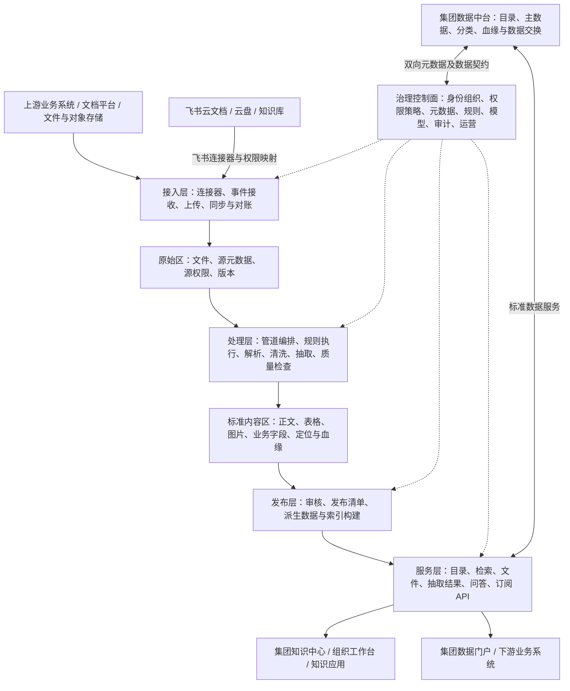

# 集团知识中心与非结构化数据中台总体架构方案

版本：V0.4（方案确认稿，补充多模态执行引擎集成）
日期：2026-10-11  
范围：业务架构、应用架构、数据架构、ELT、权限、集成与运行架构。  
本稿不包含排期、报价或 WeKnora 二开任务；具体产品与容量指标待架构确认后选定。

## 1. 方案主张

采用“**集团统一治理、组织自主运营、原始数据留存、规则驱动加工、资产统一服务**”的总体架构。

集团知识中心是用户入口和知识应用集合，非结构化数据中台是底座。底座负责从业务系统获取资料，经 ELT 转换为标准数据资产，并提供可被集团门户、数据中台和业务系统共同使用的服务。

集团建立一套统一的平台与标准；各组织拥有自己的工作空间、资料责任人、处理配置和共享边界。行政组织层级、平台管理权限、资料读取权限分别建模，避免将“集团管理员”或“上级组织”直接等同于“可读取所有文件”。

## 2. 总体逻辑架构



图中治理控制面是统一配置与决策能力，不表示每个模块必须独立部署为微服务。应用可以模块化建设，耗时和隔离要求高的处理工作通过独立 Worker 运行。

### 2.1 分层职责

| 层次 | 核心模块 | 责任边界 |
| --- | --- | --- |
| 用户与应用层 | 集团门户入口、组织工作台、知识管理、搜索问答、知识专题 | 展示授权资产、发起操作和消费服务 |
| 数据服务层 | 资产目录、内容读取、文件代理、搜索、问答、API、订阅 | 统一鉴权、版本选择、服务配额和交付契约 |
| 发布与索引层 | 审核、发布管理、全文/向量索引、知识页面 | 只发布符合质量和权限要求的数据 |
| 数据加工层 | ELT 管道、规则执行、人工复核、质量校验 | 生成可追溯的加工版本，不直接覆盖已发布内容 |
| 数据接入层 | 连接器、上传、事件接收、同步、对账 | 保留来源标识、版本和权限，可靠落地原始数据 |
| 存储层 | 对象存储、元数据与控制库、标准内容、检索索引 | 原始/标准/服务数据分区，生命周期分别管理 |
| 治理控制面 | 身份组织、权限、分类、血缘、规则、模型、审计 | 提供贯穿全链路的策略与治理能力 |
| 运行支撑层 | 队列调度、Worker、凭据、监控、备份 | 保证可恢复、可扩展、可计量的运行环境 |

## 3. 业务架构：集团治理与组织自治

### 3.1 管理对象

```text
集团
 ├─ 多级行政组织（身份平台维护）
 ├─ 集团公共知识空间（经授权发布）
 └─ 组织/项目知识空间
      ├─ 知识库与业务主题
      ├─ 数据源与接入范围
      ├─ 资产目录及知识版本
      ├─ 规则与处理管道
      └─ 成员、服务账号及共享关系
```

行政组织用于责任归属和人员属性；空间用于协作与资源隔离；知识库用于内容集合及默认策略；资产是具有独立身份的文件或知识对象。三者不能简单一一绑定，以支持跨组织项目、多个业务主题及一个人参与多个空间。

### 3.2 集团与组织职责

| 事项 | 集团 | 组织 |
| --- | --- | --- |
| 标准 | 制定分类、元数据、密级、质量和接口标准 | 补充业务字段、标签及经授权的规则 |
| 资产 | 建立集团目录，管理公共知识发布标准 | 对资产归属、内容、有效性和质量负责 |
| 处理 | 提供强制规则、公共管道和模型准入政策 | 选择允许的管道、配置业务规则、处理异常 |
| 权限 | 定义安全底线、审计及共享约束 | 维护成员和授权，审批本组织允许共享的资料 |
| 运行 | 管理容量、可用性和基础设施 | 管理用量、组织配额内的任务与成本 |

源业务系统中的受限资料应先遵守源权限。组织管理员的权限管理能力不自动构成绕过源权限的内容读取能力；必要的应急访问通过独立审批和审计处理。

## 4. 应用与服务模块

### 4.1 核心模块

| 模块 | 主要职责 |
| --- | --- |
| 集团控制台 | 标准、组织接入、政策、全局运行和审计；资产统计按授权聚合 |
| 组织工作台 | 知识空间、维护人员、数据源、处理批次、质量问题和共享 |
| 资产目录服务 | 注册资产、统一 ID、元数据、版本、业务关联、目录同步 |
| 身份组织适配 | SSO、用户、组织、用户组、调岗离职同步及身份映射 |
| 权限策略服务 | 对主体、资源、操作、环境进行决策，输出允许/拒绝及约束 |
| 接入服务 | 连接配置、增量水位、来源定位、采集调度、落地和对账 |
| 规则与管道服务 | 规则版本、继承、冲突校验、DAG、样本试跑及发布 |
| 处理执行服务 | 分派 Worker、状态机、幂等、重试、质量与人工处理衔接 |
| 模型接入服务 | 模型目录、凭据、密级准入、限额、版本及用量统计 |
| 发布服务 | 质量和权限检查、发布审批、索引构建、版本切换和撤回 |
| 内容与文件服务 | 标准内容与文件的受控读取、预览、下载、定位 |
| 搜索与知识应用 | 全文/语义检索、问答与引用、专题、可选 Wiki 和图谱 |
| 交换与订阅服务 | API、事件、下游交付、目录映射和补偿回执 |
| 质量/血缘/审计服务 | 质量规则、问题闭环、输入输出关系及操作记录 |

### 4.2 服务之间的约束

- 文件服务只接受经过授权的资产/版本/产物标识，不以调用者提供的存储路径作为访问依据。
- 加工服务读取固定输入版本，产出新结果；发布服务决定哪些结果对消费者可见。
- 搜索索引是服务投影，资产及发布元数据是权威记录。
- Worker 使用仅限任务输入、输出位置与操作的执行身份，不能持有集团全部数据访问权。
- 下游系统通过服务契约消费，不直接连接平台业务数据库或无鉴权的存储目录。

## 5. 数据架构

### 5.1 三个数据区

| 数据区 | 保存内容 | 管理原则 |
| --- | --- | --- |
| 原始区 Raw | 原文件、附件、源元数据、源权限快照、内容校验值、采集批次 | 保留来源事实；版本化、受控留存，可回放加工 |
| 标准区 Curated | 解析正文、段落/页面、表格、图片、抽取字段、脱敏版本、质量和血缘 | 具有标准 Schema 和处理版本，可校验、可重用 |
| 服务区 Serving | 发布清单、全文/向量索引、知识页面、API 数据产品及交付文件 | 由发布版本生成；可重建，撤权和失效及时作用于服务 |

分区可以由统一对象存储的命名空间实现，也可按密级拆分存储实例。标准正文和大型结果可放对象存储；需要事务和条件查询的元数据、状态及业务字段进入相应控制库/结构化数据服务。存储方案根据容量、查询及集团基础设施确定。

原始区不等于无限留存：仍执行密级、法律保留、删除审批和保留期限。只有原件读取权的加工身份可以处理原始敏感数据，消费端可只获得脱敏结果。

### 5.2 核心数据对象

| 对象 | 关键字段/关系 |
| --- | --- |
| Organization / Space | 组织 ID、父组织、空间归属、协作成员、策略 |
| SourceSystem / Connector | 来源 ID、凭据引用、采集范围、权限映射、水位 |
| Asset | 全局 ID、归属组织、责任人、类型、主题、密级、生命周期 |
| SourceBinding | 资产 ID、来源 ID、源对象 ID、源 URI、源版本；允许多个经核验来源关系 |
| AssetVersion | 资产 ID、内容版本、原始对象引用、校验值、源时间、采集时间 |
| PolicyBinding | 资产/产物范围、主体约束、操作、期限、源权限版本和策略版本 |
| RuleVersion / PipelineVersion | 不可变版本、配置、Schema、模型/提示词引用、适用范围 |
| Batch / TaskAttempt | 输入清单、版本快照、运行参数、任务状态、重试和执行记录 |
| Artifact | 解析/抽取/脱敏/分块等产物、Schema 版本、存储引用及来源定位 |
| QualityResult | 校验项、分数/错误、问题状态、人工复核记录 |
| LineageEdge | 输入和输出对象版本、步骤及执行记录 |
| Publication / IndexGeneration | 当前发布版本、产物集合、权限、构建状态、索引代次 |
| Delivery / Subscription | 消费者、交付契约、事件序号、回执、水位、撤销状态 |

资产 ID 与文件路径分离。相同内容的不同业务文件可以有不同资产身份和权限，内容去重不能把授权范围合并。

### 5.3 版本与定位

分别维护来源内容版本、加工规则版本、产物版本、发布版本和权限版本。权限可以独立于内容变化更新，不需要为了撤权重做 OCR 或 Embedding。

解析产物包含页面、章节、表格单元格或图像区域等定位；检索分块和问答引用指向明确的资产版本与位置。无法提取精确定位时记录实际定位能力，不伪造页码。

用户修改加工结果形成修订版本并保留血缘，不直接修改源业务系统。是否回写源端应另行定义受控接口。

## 6. 非结构化 ELT 与批处理架构

### 6.1 接入到发布的处理链


针对资产类型选择处理分支。合同可以抽取字段和脱敏，制度可以重点保留章节与有效期，图片可以执行 OCR；不要求所有资料执行所有步骤。

### 6.2 规则中心

规则定义包括：规则标识、版本、级别、匹配条件、输入/输出 Schema、执行器、参数、失败处理、负责人和生效状态。

采用三类规则：

1. **确定性规则**：编码、字段格式、必填项、字典映射、已确认模式的脱敏及校验。
2. **模型规则**：语义分类、复杂字段抽取、摘要；记录模型、提示词和参数，校验输出并按风险复核。
3. **人工规则节点**：处理业务争议、关键字段确认、例外审批和发布审核。

继承顺序为集团强制约束、集团模板、组织规则、管道配置、任务授权覆盖。先校验能否覆盖，再解决优先级；不允许通过任务参数关闭强制安全规则。每次运行生成解析后的规则集及指纹，避免规则更新影响正在运行的批次。

规则模板需包含样例及预期输出，试跑时展示错误、字段差异和被脱敏区域。模型生成结果不得未经校验就作为财务或其他关键业务事实。

### 6.3 管道编排与算子

管道采用有向无环图，步骤可串行、并行或按条件分支执行。算子声明输入输出类型、执行资源、超时、幂等策略、版本、是否允许外部调用及失败策略。

算子示例：文档解析、OCR、表格提取、正文清洗、敏感检测、脱敏、业务字段抽取、标签分类、质量检查、分块、向量化、索引构建、数据交付。

算子输出必须带来源与权限约束。自定义插件应隔离运行并限制网络、文件和凭据访问，不允许任意脚本直接访问控制库。模型访问通过统一模型服务执行准入和配额校验。

### 6.4 批次与执行语义

- 批次创建时保存命中的资产清单和输入版本，而非运行中不断重新查询。
- 授权在提交时检查，执行读取和最终发布时再检查当前允许范围；已撤权的任务不能继续对外发布。
- 根据资产版本、管道版本、有效规则指纹及依赖版本生成处理键；步骤重试还需保持外部写入幂等。
- 队列按至少一次交付设计，通过幂等和条件更新保证结果有效，不承诺跨系统的全局 exactly-once。
- 步骤完成先持久化结果和状态，再推进下游步骤；重试复用满足条件的检查点。
- 暂停停止新步骤派发；取消设置取消标记，执行器协作终止，阻止迟到结果发布并清理临时对象。
- 错误区分权限/规则错误、输入异常与基础设施错误；仅适合重试的错误自动重试。
- 死信和人工处理具有责任人、原因及重新提交入口；批次允许部分成功并提供逐资产结果。
- 规则恢复或发布回退均形成新的受控记录，不抹去历史；恢复旧内容时仍使用当前权限。

### 6.5 发布一致性

数据库、对象存储、搜索索引和外部消费者不能共用一个事务。采用发布清单、状态机和补偿机制：

1. 产物写入准备区，保存校验值和元数据。
2. 质量、权限和审批满足要求后建立候选发布清单。
3. 构建必要索引，确认代次就绪。
4. 以条件更新切换当前发布清单，避免旧任务覆盖新版本。
5. 通过事务性事件记录（Outbox）通知下游，重试交付并保存回执。

搜索返回命中后须按当前发布和权限再次过滤，防止过渡期间返回旧内容。发布失败保留原有有效版本；源端撤权和删除先限制在线访问，再异步清理索引及物理数据，不能等待全链路清理后才阻止读取。

### 6.6 多模态执行引擎集成：Ray、Vane Data 等

目标架构允许接入可替换的多模态处理引擎。用户提到的 Vane 暂按与描述吻合的 [AstroVela/Vane Data](https://github.com/AstroVela/vane) 作为候选讨论，具体项目仍需确认；本节不是产品选型结论。

#### 6.6.1 能力定位

| 层次 | 候选能力 | 在本平台中的位置 |
| --- | --- | --- |
| 分布式运行 | Ray Core、任务/Actor 及资源调度 | 多机器 CPU/GPU 执行底座 |
| 批量数据加工 | Ray Data 或 Vane Data | 承担经过授权的多模态管道步骤 |
| 在线模型服务 | Ray Serve 或现有集团模型平台 | 为交互或加工提供受控模型端点 |
| 模型推理/专业算子 | VLM、Embedding、OCR、ASR、视频抽帧等 | 实际处理语义与媒体内容；引擎支持不等于所有模型自动可用 |
| 集团治理与编排 | 本平台及集团已有治理服务 | 规则、输入快照、权限、审批、质量、血缘、发布和下游契约 |

Ray Data 官方资料包含批量多模态推理能力；Ray Serve LLM 提供模型服务接口。Vane Data 官方介绍提供基于 DuckDB 的多模态 SQL/Python 处理，并可以利用 Ray 运行。这些是候选产品能力，数据类型、模型、版本兼容及实际性能仍需在集团样本上验证。

参考：[Ray Data 多模态与 LLM 批处理](https://docs.ray.io/en/latest/data/working-with-llms.html)、[Ray Serve LLM](https://docs.ray.io/en/latest/serve/llm/index.html)、[Vane Data 项目](https://github.com/AstroVela/vane)。

#### 6.6.2 接入方式与责任边界

```text
规则中心与管道编排（平台）
             ↓ 已授权的任务与固定输入版本
处理执行适配服务（任务协议、状态、凭据、结果清单）
             ├─ 普通解析 / 专业算子 Worker
             ├─ Ray Data 执行后端 → Ray 集群
             └─ Vane Data 执行后端 → 本地运行或 Ray 集群
                                      ↓ 调用允许的模型
                             模型服务 / 可选 Ray Serve
             ↓ 标准产物与执行记录
质量校验、当前权限检查、发布、索引与 Open API（平台）
```

Ray Data 和 Vane Data 是可能重叠的加工路径，不强制把两套执行引擎串起来。Ray 可以作为 Vane 的运行底座；Ray Serve 可独立提供在线模型能力，与批量加工按资源和服务目标分别管理。

Go 业务服务通过内部 API/任务协议调用执行适配服务，Python 引擎作为隔离的数据执行后端。控制面持久化业务任务状态、审批和发布事实；Ray/引擎负责其作业内部调度。避免让两层分别重试同一输出而产生重复交付。

#### 6.6.3 统一执行契约

- 输入：任务 ID、组织/空间、资产版本清单、管道/规则版本、算子 Schema、输出暂存位置、资源预算、模型准入及任务作用域凭据引用。
- 状态：接收、运行、进度、等待、失败、取消与结束；引擎运行 ID 与平台任务 ID 关联。
- 输出：标准产物清单、Schema、校验值、来源定位、字段证据、质量结果、依赖/模型版本、耗时与资源用量。
- 恢复：平台执行幂等键和引擎检查点分开；重新执行只能写候选产物，发布由平台条件校验。
- 权限：引擎只能读取本任务授权对象，不获得整库凭据；已撤权的迟到结果不得发布。
- 接口：下游保持使用第 8.5 节 Open API；不直接暴露 Ray 管理端、任意 SQL/Python 执行或集群凭据。

图片产物需要来源及图像区域；音频需要时间段；视频需要时间段与帧信息；表格需单元格或行列定位。多模态检索也需明确模态、Embedding 模型及向量空间兼容，不默认将不同模型生成的向量混用。

#### 6.6.4 选型验证

以集团真实的扫描件、图片、音频、视频和表格样本验证：质量及定位、吞吐、资源峰值、重试/取消、版本稳定性、权限隔离、检查点、成本和运维。不同规模与硬件的厂商基准不能直接用作集团容量结论。

Vane 官方当前公开的相关性能对比限定在单节点环境，多节点验证仍待补充，因此不以该基准直接承诺集团分布式性能。候选引擎固定验证版本，适配层保留替换能力。[Vane 基准范围说明](https://github.com/AstroVela/vane#multimodal-inference-benchmarks)

## 7. 权限与安全架构

### 7.1 授权模型

使用 **RBAC + 资源授权 + 属性策略**：角色决定可发起的操作，资源授权决定资产范围，属性策略控制密级、来源、组织、用户组、用途及时间等条件。

```text
请求主体：用户 / 应用服务账号 / 任务执行身份
   + 操作：检索、阅读、预览、下载、导出、编辑、处理、共享、删除
   + 资源：空间、知识库、资产、版本、产物
   + 环境：授权期限、用途、接入渠道、当前策略版本
                    ↓
       策略决策：允许 / 拒绝 / 限制输出或要求审批
```

建议默认：源权限约束、平台授权和集团安全约束共同满足才允许访问。没有源权限数据时，不自动放宽；经数据责任人审批设置封闭的替代策略。

### 7.2 目录可见与内容可读分离

资产可以设置“目录不可见”“可发现但需申请”“可读取”等状态。未授权目录不暴露标题、摘要、标签、统计或存在性；允许发现的目录只展示批准的元数据，不泄露正文。

### 7.3 检索、问答和派生产物

- 检索先使用索引可表达的权限过滤，再对候选进行当前授权校验；任何兜底搜索也必须保留权限。
- 构造模型上下文前再次校验，每个引用和文件访问独立校验；不依赖提示词执行访问控制。
- 原始资料、OCR、摘要、Embedding、分块、图片及 Wiki 全部视为受保护资产或产物。
- 多来源合成内容绑定所有必需来源的约束；未经审查不得把受限内容合并到公开页面。
- 授权快照用于执行追溯，不能替代后续访问时的当前权限。
- 缓存包含主体授权上下文、资源和权限版本；撤权使相关缓存失效。

### 7.4 撤权与失效

维护权限版本和失效事件。敏感访问在权限同步超过约定新鲜度后采用拒绝或重新校验策略；正常短期缓存策略需按风险确认。

文件通过鉴权代理访问为主。签名链接限时、限资源、避免日志泄露；一旦发出的链接不一定能立即撤销，因此高敏资料可禁止直链。已经下载到外部的副本无法仅靠平台撤权收回，应通过交付协议、下游控制及审计管理。

### 7.5 模型、凭据与隔离

- 密钥由凭据服务引用，按组织和用途绑定；Worker 只获取任务必要凭据。
- 模型与解析服务按密级设置可用名单，外部调用须明确允许；数据、日志及模型留存要求一并确认。
- 网络区分入口区、应用区、处理区、数据区和外部连接出口；存储与数据库不直接公开。
- 原件及备份受加密与保留政策控制；审计避免记录完整敏感正文和访问密钥。

## 8. 集团集成架构

### 8.1 与结构化数据中台的关系

两者共同组成集团数据能力：已有中台负责结构化数据与已建立的主数据/目录能力，本平台负责非结构化原件、解析内容、处理过程及知识服务。

- 中台提供业务主键、分类及主数据；本平台将资料与合同、客户、项目、产品等业务对象关联。
- 本平台向集团目录注册非结构化资产，映射集团目录 ID 与内部资产 ID，交换元数据、血缘和质量。
- 字段抽取结果以数据契约输出到中台，在校验、复核和来源标注后供业务使用。
- 跨平台组合查询通过经授权的接口进行，不开放默认无限制的数据库联查。

集团已有目录、质量或调度平台时，应优先对接或复用，明确元数据字段的权威维护方，避免双向同步互相覆盖。

### 8.2 与数据门户的关系

门户作为集团统一入口，可采用导航接入、页面嵌入或 API 组合。共享 SSO，后台服务验证用户/应用身份与实际授权范围，不信任浏览器传来的组织 ID。

门户目录可以缓存允许公开的发现元数据，内容访问仍调用本平台。搜索问答可在本平台界面或由门户调用授权 API；跨系统权限申请需指定审批系统及回调协议。

### 8.3 与上下游系统的关系

接入契约：来源系统 ID、源对象 ID、版本、内容引用、业务主键、权限、删除标志、更新时间与增量水位。

输出契约：资产 ID、源版本、发布版本、Schema 版本、分类、权限约束、标准内容/字段、定位、血缘及有效状态。

事件类型包含采集完成、处理完成、发布、更新、失效、删除与权限变化。事件记录 ID、资源版本、序号、时间及关联执行 ID。消费者幂等处理、检查版本、保存水位；乱序时拒绝旧版本覆盖新版本，通过回查与对账补齐状态。

内容变更事件不应把敏感正文直接广播到通用消息总线。通知提供受控引用，消费者读取时重新授权。无法提供撤销回执的下游，应明确其数据交付风险和使用约束。

### 8.4 飞书文档集成架构

飞书为明确的数据来源，集成采用“范围授权 → 连接器采集 → 原始快照 → 标准加工 → 受控知识服务”的链路。飞书保留文档协作与源权限管理职责，本平台负责经授权的采集、加工和知识服务。

#### 8.4.1 集成组件


| 组件 | 职责 |
| --- | --- |
| 租户与应用配置 | 管理飞书租户、应用、凭据引用、允许接入范围和目标空间 |
| 文档/云盘/知识库适配 | 分别处理内容、文件夹遍历、知识库节点及附件，统一转换为接入契约 |
| 身份与权限适配 | 映射用户、部门及协作者，记录权限继承与源安全约束 |
| 事件与对账模块 | 消费可用事件、轮询变更、重建目录关系、补偿丢失消息 |
| 来源导航与预览 | 提供原文链接、来源定位及可选原端受控嵌入 |

#### 8.4.2 授权与数据范围

以集团管理的飞书应用作为受控采集入口；应用身份与用户授权模式按具体 API 支持和业务范围选择。API 权限开通、应用可用范围与具体文档资源授权分别核对，不将应用凭据视为租户全部资料的访问凭证。

一个连接配置绑定飞书租户、应用、组织、知识空间及知识库/文件夹/文档范围。多飞书租户分别建来源命名空间；共享应用也需要按组织限制连接范围、凭据使用和任务身份。

集团身份与飞书主体通过稳定 ID 及所属租户/应用上下文建立映射，不仅凭姓名或邮箱推断相同主体。无法映射的协作者不得自动获得集团权限；无法完整解释的源权限采用封闭策略或经批准的有限替代策略。

**采集身份与消费身份分离**：应用能读取某个文档，只证明连接器有采集权限。终端用户在本平台阅读、下载、问答或收到加工结果时仍需单独授权。文档、父目录/知识库、分享及复制下载等约束需要按源端实际能力映射；未验证的约束不得默认为允许。

#### 8.4.3 内容与版本映射

- 接入契约增加飞书租户、对象类型、对象 token/ID、知识库节点关系、来源 URL 及可获得的版本/更新时间。
- 知识库节点与实际文档对象分别记录，多个入口指向同一对象时维护关系而非盲目重复导入；权限根据入口及源规则解析，不取简单并集。
- 云文档保存可获得的原生结构化快照和分块标识；附件保存可授权获取的文件及校验值。保留图片、表格、嵌入引用的关系与可解析状态。
- 电子表格、多维表格可形成结构化产物，但仍使用对应源权限和业务契约；评论、历史版本等作为待确认范围。
- 源端没有可用版本号时，使用内容指纹及采集记录形成平台版本，并明确与源历史版本的区别。
- 解析结果按统一 Schema 进入标准区，复用集团规则、质量与发布体系，飞书连接器不另建一套知识处理规则。

#### 8.4.4 同步与异常处理

先全量建立目录与对象关系，后续通过定时增量、可用事件和周期对账共同保持更新。文档事件支持的对象、订阅主体和触发条件按官方 API 与实际租户授权验证，不承诺所有文档的所有变化都能实时通知。

重命名与移动更新元数据、目录关系并重新评估继承权限；内容变更形成新版本，触发必要加工。事件按对象/版本幂等消费，并通过回查获取当前有效状态。

限流、凭据过期、授权失效、临时网络异常和删除分别处理：重试适合恢复的错误；凭据/授权问题暂停相关采集并告警；源可见性不足时标记不可验证并按新鲜度策略限制服务，不因一次 403/404 或目录中暂未出现就物理删除原件。确认源端删除后执行失效、下游通知和保留/清理策略。

撤权先限制消费，再处理索引、缓存及下游失效。身份和源权限同步具有独立水位与新鲜度监控，不能只在文档内容变化时刷新权限。

#### 8.4.5 原文访问与可选结果写回

默认单向采集，消费端可以回跳飞书原文，由飞书执行其当前访问控制。可选云文档嵌入预览独立验证登录、组件适用范围及原端权限，不承诺组件与 API 一致覆盖所有资料类型。

如果需要将加工报告或 Wiki 发布回飞书，使用独立发布管道，明确目标空间、源链接、规则版本、审批、写权限和幂等标识。默认新建或更新平台拥有的输出文档；修改业务原文必须另行授权并检测源版本冲突。写回对象标记为平台产物，避免再次采集产生循环。

#### 8.4.6 能力验证与参考

当前仓库已有 `internal/datasource/connector/feishu/wiki/` 与 `drive/` 连接器基础。这仅证明已有采集适配代码，不代表集团权限映射、完整事件覆盖、撤权传播或结果写回已经实现；实际适配在方案确认后验证。

飞书接口与源权限会影响实施细节，参考官方资料：

- [云文档权限常见问题](https://www.feishu.cn/hc/zh-CN/articles/360044508113-%E4%BA%91%E6%96%87%E6%A1%A3%E6%9D%83%E9%99%90%E5%B8%B8%E8%A7%81%E9%97%AE%E9%A2%98)：核对文档应用授权及目录权限管理。
- [设置云文档分享、复制、下载、评论等权限](https://www.feishu.cn/hc/zh-CN/articles/360049067527-%E8%AE%BE%E7%BD%AE%E4%BA%91%E6%96%87%E6%A1%A3%E5%88%86%E4%BA%AB-%E5%A4%8D%E5%88%B6-%E4%B8%8B%E8%BD%BD-%E8%AF%84%E8%AE%BA%E7%AD%89%E6%9D%83%E9%99%90)：核对细分操作和上级安全设置约束。
- [云文档组件官方 DEMO](https://open.feishu.cn/web-component/docs-component/?source=open_platform)：评估嵌入预览能力。

### 8.5 面向下游系统的 Open API

通过统一网关开放业务能力，详细功能、建议接口目录与调用契约见 [Open API 方案](./GROUP_UNSTRUCTURED_DATA_PLATFORM_OPEN_API.md)。其中路径为目标设计示例，不是现有 WeKnora 接口清单。

| API 能力 | 对下游提供的内容 | 边界 |
| --- | --- | --- |
| 资产目录 | 空间/知识库、元数据、版本、业务主键匹配 | 目录发现不等于内容读取 |
| 内容与文件 | 标准正文、表格/图片、来源定位、预览、原件 | 原件下载与脱敏版本分别授权 |
| 检索 | 全文、语义、混合检索及元数据筛选 | 范围和命中内容均按当前权限过滤 |
| 加工结果 | 标准字段、数据产品 Schema、查询与批量交付 | 按质量、复核及发布状态交付 |
| 智能问答 | 单轮/多轮、流式回答、证据与引用 | 应用权限和实际用户权限共同约束 |
| 同步与订阅 | 全量基线、增量、发布/失效/撤权事件及回执 | 支持对账，失权后仍通知必要失效 ID |
| 加工任务 | 授权管道、提交、状态、报告、取消和重试 | 调用、读取与发布权限分开 |
| 数据生产 | 上传、入库、允许的元数据更新和删除申请 | 仅向批准的生产者开放，不默认向只读系统开放 |
| 治理反馈 | 质量、血缘、纠错反馈及访问申请 | 未授权来源裁剪，反馈需审核 |
| 自身管理 | 当前能力、用量和配额 | 不提供平台全局管理权限 |

消费者登记独立应用身份、责任人、用途、资源范围和接口能力。系统消费使用明确的系统数据授权；代用户调用采用验证过的委托身份，权限取应用范围与用户当前权限的交集。客户端传入的组织 ID 或用户 ID 不能替代身份验证。

接口默认读取已发布的有效版本；历史、草稿和原件是单独授权能力。所有异步任务、产物、导出和文件读取均需检查当前权限。API 能力管理不直接向下游暴露模型/源系统凭据、任意 SQL 或存储路径访问。

对于复制或缓存资料的消费者，必须同时定义快照—增量同步、撤权/删除通知、接收回执和对账协议。失权通知依据既往交付范围发送最小 ID，不携带已禁止读取的内容；新授权需要补齐新增范围的历史基线。

使用版本化接口规范、Schema、游标分页、幂等键、条件更新、异步任务、限流及稳定错误码。事件采用签名和重放保护，API 与事件调用纳入审计和组织用量管理。

## 9. 部署与运行架构

### 9.1 建议拓扑

```text
集团门户 / 用户 / 业务系统
             ↓
网关、SSO 适配与 API 入口
             ↓
控制与服务实例：资产、权限、组织、规则、发布、查询
             ├── 控制库 / 缓存 / 审计
             ├── 消息与任务调度
             ├── 文件与内容服务 ── 原始区 / 标准区对象存储
             └── 检索服务 ── 全文 / 向量等索引
                         ↓ 任务分发
处理 Worker 池：解析/OCR、清洗抽取、模型、索引与交付
             ↓ 受控出口
上游系统 / 集团中台 / 模型服务 / 下游系统
```

### 9.2 隔离与伸缩

- 默认共享控制面与服务入口，所有存储记录、任务和请求显式携带授权范围。
- 数据库租户字段、对象前缀或存储分区需与服务授权共同使用，单靠路径前缀不能保证隔离。
- 对高密级、区域限制或特殊组织，可拆分存储、Worker 及密钥；必要时独立数据平面，仍纳入集团目录和治理。
- 查询服务与处理 Worker 分别伸缩；CPU 密集解析、GPU/OCR 和外部模型调用分资源池。
- 组织配额覆盖存储、任务并发、模型调用和接口速率；调度避免大批次压垮交互查询。
- 标准化平台接口即可，不预先要求每个模块成为独立微服务，也不预先要求新增与已有集团基础设施重复的组件。

### 9.3 故障恢复

控制库、原始对象、规则配置、凭据引用和发布清单纳入备份；索引可由标准内容重建。恢复后检查数据库与对象版本一致性，执行任务与索引对账，再开放相关服务。

数据库恢复不能重新启用此前已撤销的权限，应与最新身份和源权限状态对账。外部模型不可用时任务等待或失败，检索与已发布内容可按实际依赖保持可用；不静默替换成未经批准的外部服务。

高可用、副本、RPO/RTO、最大文件、吞吐和并发指标尚待容量调查确定，不将此前单机部署的硬件建议作为集团生产容量承诺。

### 9.4 可观测性

链路统一使用批次、任务、资产版本及来源 ID 关联。监控同步延迟、水位滞后、权限新鲜度、队列积压、任务错误、质量、索引发布延迟、交付失败及组织成本。

业务审计与调试日志分别管理；平台运维视图尽量使用脱敏元数据，不通过日志获得原件读取能力。

## 10. 三个端到端场景

### 10.1 合同资料接入与标准字段输出

合同系统变更 → 采集合同及源权限 → 原始版本入库 → 解析/OCR → 统一字段模板抽取 → 金额日期等校验 → 必要人工复核 → 形成标准合同资产 → 发布脱敏检索版本 → 抽取结果以业务主键交付数据中台。

原件、脱敏文本与结构化结果可以有不同操作权限，但必须受来源和集团政策约束。抽取失败不阻断原件可靠落地，也不把未校验字段交付为可信事实。

### 10.2 组织知识自主维护与受控共享

组织维护制度资料 → 章节解析与有效期提取 → 质量和发布审核 → 本组织知识服务 → 申请共享指定范围 → 集团门户展示授权目录 → 目标用户检索及问答 → 引用定位到允许读取的版本。

共享撤销后新的访问受阻；派生 Wiki、摘要、缓存和引用同时遵循撤权约束。

### 10.3 集团统一规则变更与批量重处理

治理人员发布新模板 → 组织选择受影响资产 → 固定输入与规则版本 → 样本试跑及差异审查 → 批处理 → 逐项质量检查 → 审批新发布版本 → 条件切换索引与服务 → 下游接收版本变更并回执。

旧发布版本在新版本就绪前继续提供允许的服务；已经失效或撤权的内容不因“保留旧版本”继续对外提供。

## 11. 方案决策与待确认项

### 11.1 建议确认的架构原则

| 决策 | 本稿建议 | 理由 |
| --- | --- | --- |
| 定位 | 非结构化中台底座 + 集团知识应用 | 满足人员和系统两类消费需求 |
| 组织方式 | 集团共享平台、组织空间自治 | 统一标准与组织管理兼顾 |
| 数据链 | Raw → Curated → Serving | 原始回放、加工复用与服务解耦 |
| 权限 | 角色、资源与属性共同控制，源约束不默认放宽 | 防止跨组织和派生数据泄露 |
| 规则 | 版本化规则中心 + 管道编排 + 可复核执行 | 支持统一批处理和业务差异 |
| 发布 | 版本清单、条件切换、事件与补偿 | 处理多存储和下游一致性 |
| 集成 | 目录/主数据复用、契约化交换、SSO | 融入现有集团平台 |
| 实现形态 | 模块化控制服务、隔离的处理 Worker | 先明确职责，再确定部署和技术 |

### 11.2 需要业务与现有平台共同确认

- 行政组织、空间与项目协作的对应关系，哪些组织需要物理隔离。
- 目录是否允许跨组织发现，正文默认授权和集团共享审批规则。
- 源权限的完整性及替代策略，哪些系统是身份、目录、分类与审批的权威来源。
- 首批资料类型、统一规则样例、敏感字段和关键字段复核要求。
- 模型是否全私有化，各密级的存储、解析和外部访问要求。
- 现有中台、门户及调度/质量/目录服务可复用的边界与接口。
- 飞书租户与应用管理方式、接入文档范围、身份映射、权限/事件能力，以及是否需要嵌入或结果写回。
- 下游 Open API 消费者、系统/代用户身份、开放能力和数据范围，以及同步、撤销与副本处置契约。
- 数据删除、保留、下游副本及签名链接的控制要求。
- 规模、并发、吞吐、时效和可用性指标。
- 用户所指 Vane 的具体项目、多模态资料占比、集团现有 GPU/模型资源，以及 Ray/Vane 等候选执行后端的验证范围。

## 12. 与 WeKnora 的关系

本方案是集团业务的目标架构，不以 WeKnora 当前模块和界面作为需求边界。WeKnora 可以作为候选知识应用与部分处理能力的基础，但是否复用、如何扩展、哪些能力由集团已有平台提供，需要在方案确认后做逐项适配验证。

当前不作二开范围和工期结论。下一步先审阅第 11 节的架构原则与待确认项，再据此形成组织权限矩阵、数据模型和集成契约，最后评估实现路径。
